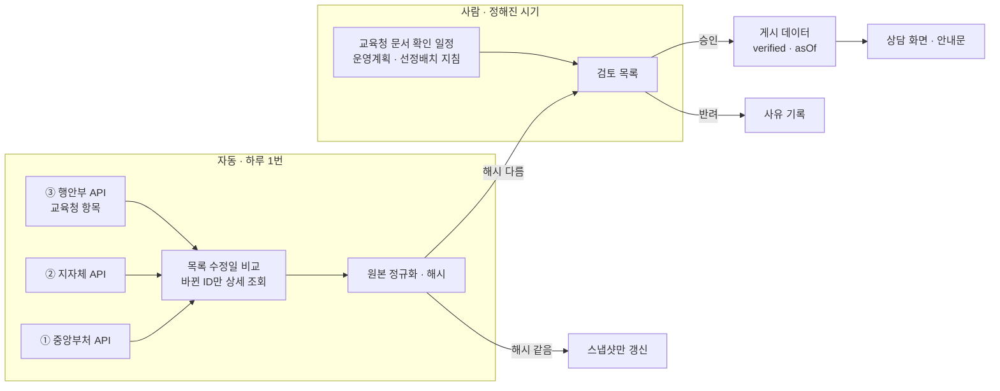

# 데이터 갱신 파이프라인

제도는 해마다, 때로는 학년 중간에도 바뀐다. 바뀐 것을 **자동으로 알아차리고, 사람이 확인한 뒤에만** 화면에 반영하는 구조.
출처별 상세는 [제도-출처-지도.md](제도-출처-지도.md)에 있다.

> **한 줄 — 자동으로 감지하고, 사람이 확정한다.**
> 공식 데이터가 바뀌어도 바로 덮어쓰지 않는다. 「검토 필요」로 올리고 사람이 승인해야 `verified`가 붙는다.
> 판정하지 않는다는 원칙(1번), 1면에는 확실한 것만 올린다는 원칙과 같은 이유다.

---

## 1. 전체 흐름

---

## 2. 층마다 갱신 방법

| 층 | 무엇을 | 어떻게 감지 | 누가 확정 | 주기 |
|---|---|---|---|---|
| ① 중앙부처 복지 | 대상 · 지원 내용 · 서식 · 근거법령 | 중앙부처복지서비스 API 상세의 원본 해시 비교 | 운영자 | 매일 감지 |
| ② 지자체 자체사업 | 목록 · 시행 기간 · 대상 | 지자체복지서비스 API 목록의 `lastModYmd`(최종수정일) 비교 → 바뀐 것만 상세 | 운영자 (후보 목록은 원래 「확인 필요」라 자동 노출 유지) | 매일 감지 |
| ③-a 교육청 금액 · 구비서류 · 신청 시기 | 치료지원 · 방과후 · 통학 | 행안부 API `cond[수정일시::GTE]`로 **바뀐 것만** 조회 → 해시 비교 | 운영자 + 교육청 담당자 | 매일 감지 |
| ③-b 교육청 서식 번호 · 선정 절차 | 진단·평가 의뢰서 번호, 기초조사 서류 담당 | **API 없음.** 아래 「문서 확인 일정」대로 사람이 게시판을 본다 | 운영자 | 연 2~3회 + 수시 |
| ④ 교육지원청 연락처 | 특수교육지원센터 번호 | 사람이 확인 | 운영자 | 분기 1회 |

**덮어쓰지 않는 칸** — 우리가 확인한 문장(`summary`), 경고, 1면 문구는 API가 바꾸지 못한다. API가 바꾸는 것은
「공식 정보」 칸과 검토 목록뿐이고, 우리 데이터는 사람이 승인할 때 고친다.

---

## 3. 교육청 문서 확인 일정 (③-b)

조사에서 나온 게시 시기를 그대로 달력으로 옮겼다. **연 1회 확인으로는 부족하다** — 경남은 해마다 게시 달이 다르고(2월~8월),
인천은 학년 중간(9월)에 바뀐 길라잡이를 따로 올렸다.

| 시기 | 확인할 것 | 해당 시도 |
|---|---|---|
| **1~2월** | 그해 특수교육 운영계획 (치료지원 금액 · 카드) | 대부분 (경기 1월 · 인천 1월 · 강원 2월 · 부산 2월 …) |
| **2~3월** | 선정·배치 지침 · 길잡이 (서식 번호) | 강원 3월 · 부산 3월 · 세종 3월 |
| **3~8월 매월** | 늦게 올라오는 운영계획 · 다음 학년도 선정·배치 계획 | **경남(2026은 6월)** · 세종(5월) · 전남(7월) · 전북(8월) · 대전·충남(6월) |
| **수시** | 학년 중 변경 공지 | 인천(9/1 치료지원 길라잡이 변경) |
| **기관 변동 시** | 기관명 · 도메인 · 관할 | 전남광주 통합(2026 하반기) |

확인 결과는 검토 목록에 사람이 직접 올린다 (출처 URL · 게시일 · 바뀐 칸).

---

## 4. 기술 구성 (해커톤 범위)

| 부분 | 선택 | 근거 · 한도 |
|---|---|---|
| 정기 실행 | **Vercel Cron**, 하루 1번 `0 18 * * *` (UTC, 한국 새벽 3시경) | Hobby 플랜은 **하루 1회까지** · 실행 시각 ±59분 · 실패해도 재시도 없음 · 함수 최대 300초 ([Vercel 문서](https://vercel.com/docs/cron-jobs/usage-and-pricing)) |
| 실행 라우트 | `/api/cron/sync` — `CRON_SECRET`을 확인하는 것만 받는다 | Vercel이 `Authorization: Bearer` 헤더로 보낸다 |
| 저장 | **Supabase** (무료) | DB 500MB · **7일 동안 활동이 없으면 일시정지** — 매일 도는 cron이 막아 준다 ([Supabase 문서](https://supabase.com/docs/guides/platform/free-project-pausing)) |
| 파서 | 이미 있는 `app/lib/data-go-kr.ts` · `bokjiro.ts` · `localwelfare.ts` · `gov24.ts` | Supabase Edge Function은 쓰지 않는다 (CPU 2초 제약, 파서를 다시 짜야 함) |

**하루 호출 한도 안에 든다** — 강원·경남 기준으로 목록 몇 번 + 바뀐 상세 몇 건.

| API | 개발계정 한도 | 하루 사용 예상 |
|---|---|---|
| 중앙부처복지서비스 | 100건 | 목록 1~2 + 매핑된 상세 4 ≈ 6 |
| 지자체복지서비스 | 1,000건 | 시도 2 + 바뀐 상세 수 건 |
| 공공서비스(혜택) | 10,000건 | 교육청 2곳 목록 + 바뀐 상세 |

**같은 일을 두 번 해도 결과가 같게(멱등)** 만든다 — Vercel이 cron을 빠뜨리거나 두 번 보낼 수 있다고 문서에 적혀 있다.
`(출처, 서비스ID, 해시)`가 같으면 아무것도 새로 쓰지 않는다.

---

## 5. Supabase 테이블 (설계안)

> 공식 근거가 있는 구성이 아니라 **설계 제안**이다. 아동 정보를 담는 칸은 없다.

| 테이블 | 칸 | 하는 일 |
|---|---|---|
| `sync_runs` | id · 시작 · 끝 · 출처별 건수 · 오류 | cron이 돌았는지, 무엇을 몇 건 봤는지 |
| `raw_snapshots` | 출처 · 서비스ID · 받은 시각 · 원본 수정일 · **해시(sha256)** · 원본 | 마지막으로 본 공식 원본. 해시가 같으면 시각만 바꾼다 |
| `review_queue` | 출처 · 서비스ID · 이전 해시 → 새 해시 · 바뀐 칸 · **상태(대기/승인/반려)** · 검토자 메모 · 문서 URL | 사람이 볼 목록. 교육청 문서 확인 결과도 여기 올린다 |
| `programs` | 제도 ID · 지역 · 게시 값 · `verified` · `source` · `asOf` | 화면이 읽는 승인된 값. 지금의 `data.ts`가 옮겨 갈 자리 |
| `doc_watch` | 시도 · 문서 종류 · 게시판 URL · 다음 확인 예정일 · 마지막 확인일 | 3장 달력을 데이터로. 예정일이 지나면 검토 목록에 알림 |

**지금 `data.ts`는 그대로 둔다.** 해커톤까지는 Supabase를 「감지와 검토 목록」에만 쓰고, 화면은 `data.ts`를 계속 읽는다.
승인된 값을 사람이 `data.ts`에 옮기는 단계부터 시작하고, 그다음에 `programs` 테이블로 옮긴다.

---

## 6. 하지 않는 것

| 하지 않음 | 이유 |
|---|---|
| 교육청 게시판 자동 수집 | 제주 · 충남 · 대전 본청 · 충북특수교육원은 robots.txt로 전체를 막았다. RSS는 16곳 중 0곳. 사람이 확인한다 |
| 정부24 화면 수집 | `gov.kr` robots.txt가 막는다. 행안부 API를 쓴다 |
| API 값으로 우리 데이터 자동 덮어쓰기 | 판정하지 않는다 · 1면에는 확실한 것만 |
| AI로 바뀐 내용 확정 | 「규칙이 고르고, AI는 못 하는 것만 한다」. AI는 바뀐 칸 요약(검토 보조)까지만 |
| 아동 정보 저장 | 저장하지 않는 것이 판매 논리다. 파이프라인 테이블에는 제도 데이터만 있다 |

---

## 7. 단계

| 단계 | 내용 | 시연에서 보여줄 것 |
|---|---|---|
| **1. 감지** | `/api/cron/sync` + `sync_runs` · `raw_snapshots` | 「어젯밤 ○건 확인, ○건 바뀜」 |
| **2. 검토 목록** | `review_queue` + 간단한 검토 화면 (바뀐 칸 앞뒤 비교 · 승인/반려) | 금액이 바뀐 제도를 승인하면 `asOf`가 갱신되는 장면 |
| **3. 문서 일정** | `doc_watch` — 예정일이 된 교육청 문서를 검토 목록에 올림 | 「경남 운영계획 확인 예정 — 3월부터 매월」 |
| 4. (해커톤 뒤) 게시 데이터 이전 | `data.ts` → `programs` | — |

**발표에서의 쓰임** — 사업 멘토가 약점으로 짚은 「업데이트 · 유지보수」에 대한 답이다.
「공식 API 3개를 매일 확인하고, API가 없는 서식 번호는 교육청 게시 달력대로 사람이 확인합니다.
바뀐 것은 자동으로 반영하지 않고 확인을 거칩니다.」
